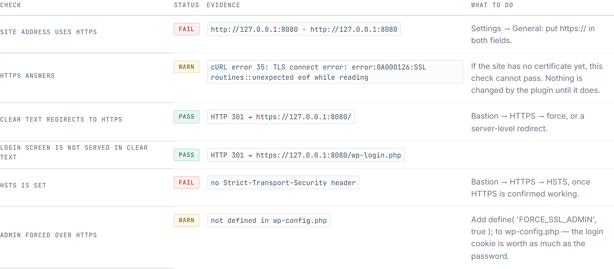
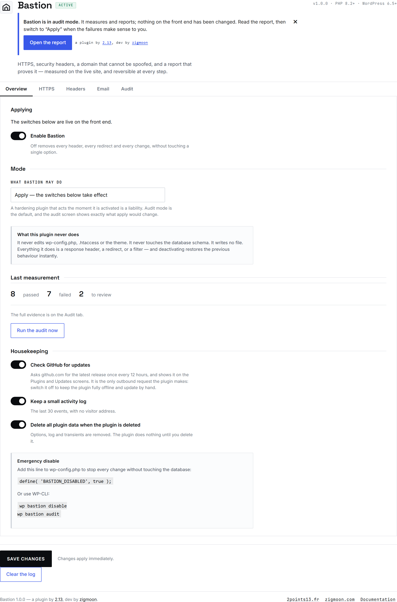
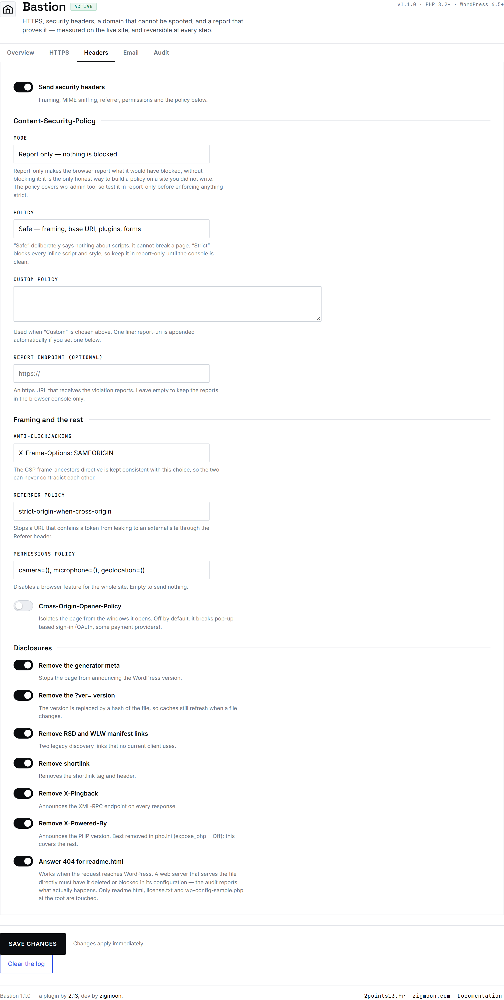
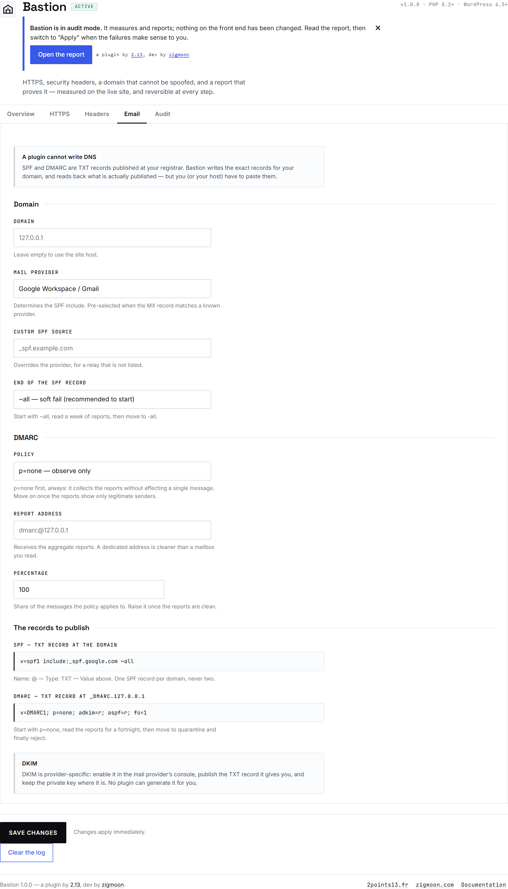
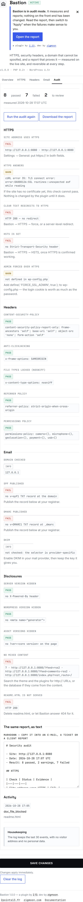

<p align="center">
  
</p>

<h1 align="center">Bastion</h1>

<p align="center">
  <b>HTTPS, security headers, a domain that cannot be spoofed — and a report that proves it.</b><br>
  A WordPress hardening plugin that changes nothing until you ask, and measures the live site when it does.
</p>

<p align="center">
  <a href="https://github.com/zigmoon/bastion/releases/latest"><b>⬇ Download</b></a> ·
  <a href="#the-report">The report</a> ·
  <a href="#install">Install</a> ·
  <a href="#the-safety-model">Safety</a> ·
  <a href="#credits">Credits</a>
</p>

<p align="center">
  
  
  
  
  
</p>

## The report



Every row is a measurement, not a setting. Bastion fetches the site's own pages, reads the headers the server actually returned, and queries DNS — then prints what it found. A check that cannot be measured says so; it never turns green by default.

Measured on the local test install, before and after applying the policy:

| | Passed | Failed | To review |
|---|---|---|---|
| Fresh install, audit mode | 0 | 15 | 3 |
| After the switches are applied | **9** | 5 | 4 |

The five remaining failures are the honest ones on a local sandbox: no certificate (so no TLS, no HSTS), no DNS for `127.0.0.1` (so no SPF, no DMARC), and PHP's built-in server hands `readme.html` straight from disk without ever calling WordPress.

## What it does

**HTTPS** — redirect clear text to TLS with the status code you choose, behind a proxy you declare trusted. A **dry run** logs what would have been redirected instead of redirecting it, and only `GET` and `HEAD` are ever redirected: a 301 on a POST silently turns it into a GET and loses the form. The login screen is covered too — `wp-login.php` is a standalone file that never fires `template_redirect`, so it gets its own hook, because leaving it out would leave the one page that carries a password in clear text. The port is kept: a site served on `8443` is not sent to `443`, where nothing is listening.

**HSTS** — `Strict-Transport-Security` with a max-age you control, `includeSubDomains` and `preload` as separate, deliberate choices. Off by default, because a browser that has seen it refuses plain HTTP for the whole max-age even if you remove the header afterwards.

**Headers** — Content-Security-Policy (report-only by default), `X-Frame-Options` kept consistent with the CSP `frame-ancestors` directive, `X-Content-Type-Options: nosniff` to lock file types, `Referrer-Policy`, `Permissions-Policy` (`camera`, `microphone` and `geolocation` off by default — `payment` is left alone, because `payment=()` breaks Apple Pay, Google Pay and Stripe's express checkout), and `X-XSS-Protection: 0`.

**Email** — the exact SPF and DMARC TXT records for your domain, written for the provider the MX record points at, with the responsible progression built in: `~all` before `-all`, `p=none` before `quarantine` and `reject`.

**Disclosures** — no generator meta, no `?ver=<core version>`, no RSD or WLW manifest link, no shortlink, no `X-Pingback`, no `X-Powered-By`, and a 404 for `readme.html`.

## The two policies

The CSP preset matters more than the switches, so it is spelled out on screen:

| Preset | Policy | Can it break a page? |
|---|---|---|
| **Safe** (default) | `frame-ancestors`, `base-uri` | **No.** It says nothing about scripts, styles, plugins or forms. |
| **Strict** | `default-src 'self'` and everything down from it, including `object-src 'none'` and `form-action 'self'` | Yes — every inline script and style. Keep it in report-only until the console is clean. |
| **Custom** | Your own line | Depends on what you write. |

`Safe` deliberately omits `default-src`: that directive is the fallback for `script-src`, so adding it would block the inline scripts of the theme and every other plugin. It also leaves out `object-src 'none'`, which stops `<embed>` and `<object>` from loading a PDF, and `form-action 'self'`, which stops a checkout page from posting to a payment gateway. Framing and base-tag injection — the parts that cannot break a page — are closed anyway.

A CSP that is set to report-only is reported as **to review**, never as a pass: nothing is blocked until the mode is changed, and the audit says so in the evidence column.

## The safety model

A hardening plugin that acts the moment it is activated is a liability. Five decisions follow from that:

1. **Audit mode is the default.** Installed, the plugin measures and reports and changes nothing on the front end. Every feature asks one gate — `applies()` — before acting, so "audit" really means read-only.
2. **The switches default to off**, including the redirect and HSTS. The only thing on by default is the audit itself.
3. **The redirect has a dry run**, on by default, that logs to the activity log instead of redirecting.
4. **No file is ever written.** No `.htaccess`, no `wp-config.php`, no theme edit, no database schema. Everything is a response header, a redirect or a filter.
5. **`define( 'BASTION_DISABLED', true );` in `wp-config.php`** stops everything in memory, without the plugin touching the database to recover.

There is also `wp bastion disable` and `wp bastion audit-only` for a terminal.

## The settings screen

| Overview | Headers | Email |
|---|---|---|
| [](docs/admin-overview.png) | [](docs/admin-headers.png) | [](docs/admin-email.png) |

Click a panel for the full-size view. Five tabs: **Overview**, **HTTPS**, **Headers**, **Email**, **Audit**. Every boolean is a real switch — native input, keyboard-navigable, `role="switch"`. A generated DNS record is copied with one click.



## Install

1. Download `Bastion-1.1.2.zip` from [Releases](https://github.com/zigmoon/bastion/releases).
2. **Plugins → Add New → Upload Plugin**, install, activate.
3. **Settings → Bastion**: press **Run the audit**, read the report.
4. Fix what you can at the server level first. Then switch to **Apply** and turn on what you need, one group at a time.

## Limits, stated plainly

- **A plugin cannot write DNS.** SPF and DMARC are TXT records at your registrar. Bastion writes them for your domain and reads back what is actually published; you or your host paste them.
- **DKIM is provider-specific.** Enable it in the mail provider's console and keep the key it gives you. No plugin can generate it for you.
- **A plugin cannot delete a static file safely.** `readme.html` blocked by Bastion only works where the request reaches WordPress; when the web server serves the file directly, delete it or block it in the server configuration. The audit tells you which case you are in.
- **HSTS cannot be undone quickly.** Start with a short max-age and confirm the site is stable before raising it.
- **The redirect is a safety net, not a replacement** for a server-level redirect. When both are configured, the server answers first and Bastion never sees the request.
- **CSP is not retrofitted for you.** The safe policy cannot break a page because it ignores scripts; a strict policy needs the violations read before it is enforced.

## Compatibility

| | |
|---|---|
| WordPress | 6.5 → 7.1 (latest stable at the time of writing: 7.1.4) |
| PHP | 8.2 → 8.5 |
| Database | No table created; `wp_options` and two transients |
| Multisite | Yes, settings per site |
| PHP extensions | None beyond a standard WordPress install (`dns_get_record` or `checkdnsrr` for the DNS checks) |
| CLI | `wp bastion audit`, `settings`, `enable`, `disable`, `audit-only` |
| Outbound requests | One, to `github.com`, for the update check — switchable off |

## Updates

The plugin lives on GitHub, not in the WordPress.org directory, so it brings its own update check. It declares `Update URI` — the header WordPress 5.8 added for exactly this — and answers the filter core then calls; the new version appears on **Plugins** and **Updates**, "Update now" installs it, and automatic updates can be enabled like any other plugin. The check runs at most once every 12 hours, and **Settings → Bastion → Housekeeping** switches it off entirely.

## Development

```bash
php tests/run.php                 # settings, headers, redirects, DNS, audit
php tests/smoke.php               # boot, hooks, admin render
php tools/build-translations.php  # .pot + fr_FR + es_ES, compiled and verified
pwsh -File tools/build-zip.ps1    # dist/Bastion-<version>.zip, hash-verified
pwsh -File tools/release.ps1 -Bump patch
```

## Quality

- **254 automated assertions.** Two suites, no WordPress installation needed: `211 passed, 0 failed` and `43 passed, 0 failed`.
- **Checked on real installs.** WordPress 7.1.4 on PHP 8.3: headers read back with `curl -I`, `?ver=` inspected on the rendered page, `readme.html` probed, `wp-login.php` probed for its redirect, `debug.log` left clean, audit run from the dashboard and from WP-CLI. Linted and tested on **PHP 8.2, 8.3, 8.4 and 8.5** with `E_ALL` — no notice, no deprecation.
- **Bugs found by its own tests and by that install**: the audit read WordPress's header dictionary with an array cast, so every header check reported "absent"; it probed `https://` on an `http://` install, so every check reported "unreachable"; the redirect skipped `wp-login.php`, because that file never fires `template_redirect`; and the redirect dropped a non-standard port. Each one is now covered by an assertion.
- English source strings, complete French and Spanish translations, `.pot` catalogue.

## Credits

Bastion is a plugin by [2.13](https://2points13.fr/), dev by [zigmoon](https://zigmoon.com/). Licence GPL-2.0-or-later.
